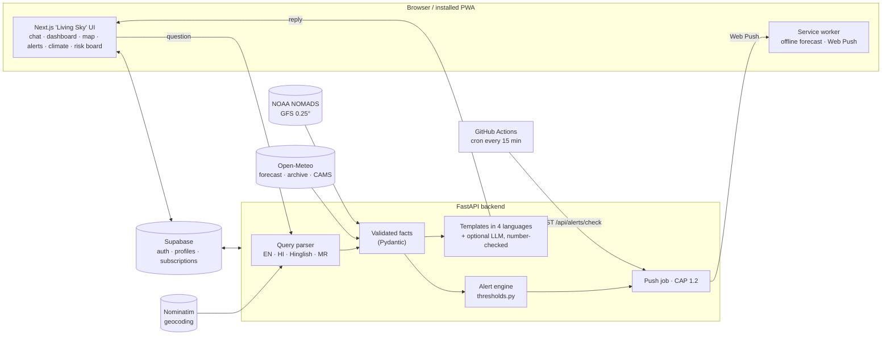
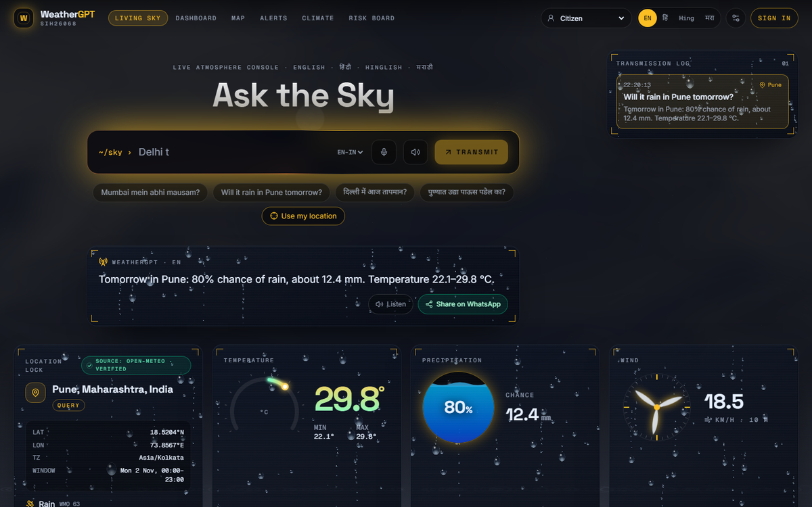
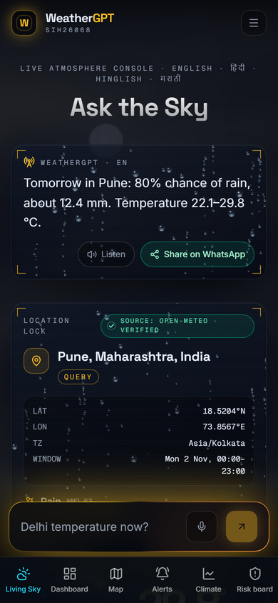
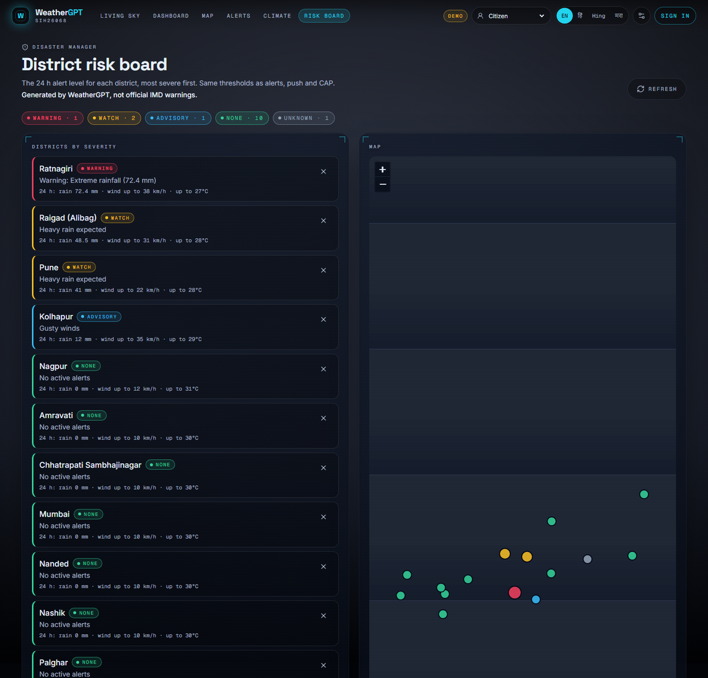
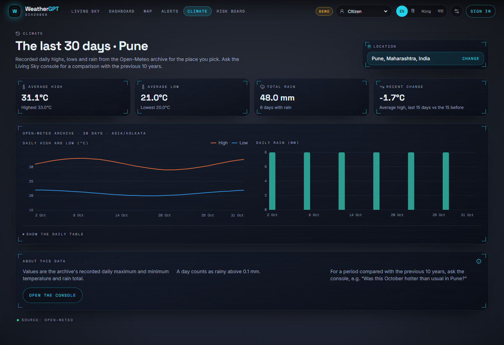

# WeatherGPT

SIH 2026 - Problem Statement SIH26068

## For SIH26068 judges

**WeatherGPT is a conversational weather platform for India that never makes up a number.** Ask in English, Hindi, Hinglish or Marathi, by typing or by voice: "Will it rain in Pune tomorrow?", "aur parso?", "पुण्यात उद्या पाऊस पडेल का?". The answer comes from live Open-Meteo data, NOAA GFS model runs and a 10-year climate archive. Each value is validated, turned into a small set of facts, and only then put into words. Even when an LLM rewrites the text, it is rejected unless every number in it appears in the facts.

On top of that sit:
- a deterministic alert engine (advisory / watch / warning) with Web Push, CAP 1.2 and WhatsApp dissemination
- role-specific advisories for farmers, aviation, disaster managers and researchers
- a district risk board
- an installable, offline-capable mobile PWA

All alerts are labelled "Generated by WeatherGPT, not official IMD warnings".

### Problem statement coverage

| SIH26068 requirement | What WeatherGPT does | Where |
|---|---|---|
| Conversational AI | Living Sky chat console with follow-ups ("aur parso?", "what about Mumbai?"); grounded templates; optional LLM for wording only, number-checked | `backend/api/chat.py`, `backend/llm/` |
| Multilingual | English, Hindi (Devanagari), Hinglish, Marathi: replies, UI, weather descriptions, voice (en-IN / hi-IN / mr-IN) | `llm/response_generator.py`, `context/I18nContext.tsx` |
| Natural-language queries | Intent, place, date, parameter, language: **91.7% exact match on a held-out set** | `llm/query_parser.py`, `tests/eval/` |
| Real-time weather and forecasts | Open-Meteo current + 7-day hourly (rain, probability, wind, gusts, visibility, cloud, UV) | `weather/open_meteo.py` |
| NWP integration | NOAA GFS 0.25° via NOMADS in chat ("What does GFS say…") and a GFS vs Open-Meteo comparison | `nwp/`, `roles/compare.py` |
| Extreme-weather alerts | One threshold table drives the engine, chat advisories, risk board, push and CAP | `thresholds.py`, `alerts/` |
| Early-warning dissemination | Web Push when severity *becomes* warning (cron job), CAP 1.2 XML, WhatsApp share | `dissemination/`, `docs/EARLY_WARNING.md` |
| Climate trends | A period vs the same dates over the previous 10 years, in chat and on `/climate` | `climate/` |
| Role-specific advisories | Farmer (spray / irrigate / harvest / sow windows), aviation briefing (kt), disaster-manager board, researcher bias/MAD | `roles/`, `docs/ROLE_ADVISORIES.md` |
| Location-based | Named place → GPS → conversation → saved profile; Nominatim geocoding, never hard-coded coordinates | `api/chat.py`, `geocoding.py` |
| GIS | Live weather map on `/map` (MapLibre GL + deck.gl): tap anywhere for point weather, temperature / humidity / wind / rain / heat-stress layers over a 72 h time slider, broadcast mode with 3D terrain, rain columns and wind particles. Leaflet severity map on the risk board | `components/map3d/`, `api/map.py`, `components/map/` |
| Air quality | Indian AQI (CPCB method) from CAMS PM2.5/PM10, plus UV | `air/` |
| Mobile-first | PWA (installable, offline last forecast), lite mode for 2G/3G and low-RAM phones, bottom nav, voice | `weathergpt-web/` |
| Accessibility | axe-core checks on every route (WCAG 2.1 AA, desktop + mobile), keyboard navigation, screen-reader replies | `e2e/a11y.spec.ts` |

### Accuracy

| Parser benchmark | Exact match (all fields right) |
|---|---|
| **Held-out set, 24 queries in EN / HI / Hinglish / MR, written after tuning, scored once** | **91.7%** (41.7% before the work) |
| Tuning set, 120 queries (used to fix the parser, so optimistic) | 99.2% |

Run it yourself: `backend/.venv/Scripts/python tests/eval/run_eval.py --quiet --queries tests/eval/heldout.jsonl`. Details are in `IMPROVEMENTS_REPORT.md`.

### Architecture



### Screenshots

| Chat answer (desktop) | Chat answer (phone) |
|---|---|
|  |  |
| **District risk board** | **Climate: last 30 days** |
|  |  |

Screenshots use the mocked test data from the Playwright suite.

### Run it in 5 minutes (Windows, PowerShell)

You need Python 3.11 and Node.js 22. No API keys are needed: the weather sources are free and keyless, and without an LLM key the deterministic parser and templates are used.

```powershell
# 1. Backend: terminal 1, from the repo root
cd backend
python -m venv .venv
.\.venv\Scripts\Activate.ps1          # if blocked: Set-ExecutionPolicy -Scope CurrentUser RemoteSigned
pip install -r requirements.txt
uvicorn main:app --port 8000          # check: http://localhost:8000/health

# 2. Frontend: terminal 2, from the repo root
cd weathergpt-web
copy .env.local.example .env.local    # placeholders are fine for demo mode
npm install
npm run dev                           # open http://localhost:3000
```

Then:
1. Ask "Will it rain in Pune tomorrow?" or "पुण्यात उद्या पाऊस पडेल का?".
2. Pick a role in the top bar to see farmer or aviation advice.
3. Use **Sign in → Enter demo** for the dashboard, then open **Risk board**.

Real Supabase keys are needed only for sign-up and push. To deploy: `docs/DEPLOYMENT.md`. Tests: `python -m pytest tests/ -q` (backend, all mocked) and `npx playwright test` (frontend).

---


## Prototype Architecture

| Layer    | Technology                             |
|----------|----------------------------------------|
| Frontend | Next.js · TypeScript · Tailwind · MapLibre GL · deck.gl · Leaflet |
| Backend  | FastAPI · Pydantic v2 · HTTPX          |
| Weather  | Open-Meteo (primary) · GFS/NOAA (future NWP) |
| GIS      | GeoPandas · Shapely · PyProj           |
| NWP      | xarray · cfgrib                        |
| Voice    | LiveKit Agents (integration phase)     |

---

## Development Rule

> **The LLM must never be the source of weather facts.**  
> Weather data must follow this pipeline:
>
> ```
> Open-Meteo → Pydantic validation → structured WeatherResponse → LLM grounding layer
> ```

---

## Backend Setup

### 1. Activate the virtual environment

**Windows (PowerShell)**
```powershell
cd backend
.\.venv\Scripts\Activate.ps1
```

**macOS / Linux**
```bash
cd backend
source .venv/bin/activate
```

### 2. Install dependencies

```bash
pip install -r requirements.txt
```

Versions are pinned. `xarray` and `cfgrib` (which needs the ecCodes library) serve `/api/nwp`; if they
cannot be imported the API still starts and only `/api/nwp` is left out (a warning is logged).
GIS and agent packages not used yet (geopandas, shapely, pyproj, langgraph) are in
`requirements-future.txt`.

### Configuration

`backend/.env` is loaded at startup if it exists (python-dotenv); real environment variables win.
See `.env.example` for the LLM and Supabase keys. Also:

| Variable | Default | Purpose |
|----------|---------|---------|
| `ALLOWED_ORIGINS` | `http://localhost:3000,http://127.0.0.1:3000` | Comma-separated CORS origins |

### 3. Run FastAPI (development)

```bash
# From the backend/ directory with the venv active
uvicorn main:app --reload --port 8000
```

The API will be available at `http://localhost:8000`.  
Interactive docs: `http://localhost:8000/docs`

---

## API Reference

### Health check

```
GET /health
```

**Response**
```json
{
  "status": "ok",
  "service": "WeatherGPT API"
}
```

---

### Real-time weather

```
GET /api/weather?latitude={lat}&longitude={lon}
```

| Parameter   | Type  | Required | Range        | Description                     |
|-------------|-------|----------|--------------|--------------------------------------|
| `latitude`  | float | ✅       | −90 to 90    | Decimal degrees (WGS-84)             |
| `longitude` | float | ✅       | −180 to 180  | Decimal degrees (WGS-84)             |

**Data source:** [Open-Meteo Forecast API](https://api.open-meteo.com/v1/forecast)  
No API key required. Provides current conditions + a 7-day hourly forecast (168 hours).
`retrieved_at` is always UTC; hourly `time` values are local wall time in `timezone`.

#### Example request — Pune, India

```bash
curl "http://localhost:8000/api/weather?latitude=18.5204&longitude=73.8567"
```

#### Example response structure

```json
{
  "source": "open-meteo",
  "latitude": 18.519999,
  "longitude": 73.870003,
  "timezone": "Asia/Kolkata",
  "retrieved_at": "2026-09-09T15:52:21.000Z",
  "current": {
    "time": "2026-09-09T21:00",
    "temperature_2m": 27.4,
    "relative_humidity_2m": 76.0,
    "precipitation": 0.0,
    "wind_speed_10m": 11.2,
    "wind_direction_10m": 250.0,
    "weather_code": 3
  },
  "hourly": {
    "time": ["2026-09-09T00:00", "2026-09-09T01:00", "..."],
    "temperature_2m": [25.1, 24.8, "..."],
    "precipitation_probability": [5, 5, "..."],
    "precipitation": [0.0, 0.0, "..."],
    "wind_speed_10m": [9.5, 8.7, "..."],
    "wind_direction_10m": [245.0, 250.0, "..."],
    "weather_code": [3, 2, "..."],
    "relative_humidity_2m": [81.0, 83.0, "..."]
  }
}
```

**`weather_code`** follows the [WMO Weather Interpretation Codes (WW)](https://open-meteo.com/en/docs#weathervariables).
**`wind_direction_10m`** is the direction the wind blows *from*, in degrees (0 = north, 90 = east).

---

### Conversational weather

```
POST /api/chat
```

Turns a natural-language question into a grounded reply. The LLM is never the source of weather facts.

**Query flow**

```
User message
→ query understanding (backend/llm/query_parser.py)
→ location resolution (Nominatim + optional trusted profile)
→ Open-Meteo (backend/weather/open_meteo.py)
→ validation / fact selection (backend/query_service.py)
→ grounded response (backend/llm/response_generator.py)
```

**Request**

| Field | Type | Required | Notes |
|-------|------|----------|--------|
| `message` | string | yes | 1–2000 characters |
| `latitude` | float | no | Request-time GPS for this query (−90 to 90) |
| `longitude` | float | no | Request-time GPS for this query (−180 to 180) |

`user_id` and client `default_*` fields are ignored. Identity for a saved default comes only from `Authorization: Bearer <Supabase access token>`.

```bash
curl -s http://localhost:8000/api/chat ^
  -H "Content-Type: application/json" ^
  -d "{\"message\": \"Pune mein kal baarish hogi kya?\"}"
```

**Response**

```json
{
  "message": "In Pune tomorrow, total precipitation is … (Open-Meteo).",
  "intent": {
    "intent": "forecast",
    "location_name": "Pune",
    "date_reference": "tomorrow",
    "weather_parameter": "precipitation",
    "language": "hinglish"
  },
  "location": {
    "name": "Pune, …",
    "latitude": 18.52,
    "longitude": 73.85,
    "source": "explicit_query"
  },
  "weather": {
    "source": "open-meteo",
    "location": "Pune, …",
    "requested_time": "tomorrow (…)",
    "timezone": "Asia/Kolkata",
    "precipitation": 4.8,
    "precipitation_probability": 80,
    "weather_code": 63,
    "weather_description": "Rain"
  },
  "advisory": {
    "severity": "low",
    "condition": "Routine conditions",
    "advisory": "No specific weather advisories at this time.",
    "reasons": ["There is a 80% chance of rain."]
  },
  "source": "open-meteo"
}
```

**Date references** (`intent.date_reference`)

| Value | Window (location's local time) | Examples |
|-------|--------------------------------|----------|
| `now` | current observation | "right now", "abhi" |
| `today` | today 00:00–23:00 | "aaj", "आज" |
| `this_afternoon` | today 12:00–17:00 | "dopahar", "दोपहर" |
| `tonight` | today 20:00 to 05:00 the next morning | "raat", "रात" |
| `tomorrow` | tomorrow | "kal", "कल" |
| `day_after_tomorrow` | today + 2 | "parso", "परसों" |
| `monday` … `sunday` | next occurrence, counting today | "Friday", "shukravar", "शुक्रवार" |

If the window is not inside the 7-day forecast, `weather.period_available` is `false`.
Forecast periods report the period's most significant WMO code (with `weather_description`), mean
hourly humidity, peak wind and its direction, total precipitation and the peak probability.

**Weather parameters** (`intent.weather_parameter`): `temperature`, `high_temperature`,
`precipitation`, `heavy_rain`, `rain_likelihood`, `wind`, `strong_wind`, `storm`, `humidity`,
`advisory`, `general`. Each one limits the `weather` facts to what it is about; the advisory always
evaluates the full period, so heavy rain is still flagged on a temperature question.

**Advisory in the reply:** the reply includes the advisory only when a threshold check fired or the
user asked for advisories. Reply text is localised for `hi`, `hinglish` and `mr`, including the WMO
weather descriptions ("Dense drizzle" → "तेज़ बूँदाबाँदी" / "tez boondabaandi" / "जोरदार रिमझिम",
`backend/llm/weather_codes.py`). The `advisory` object and `weather.weather_description` stay in English.

**Location priority** (see `backend/api/chat.py`)

1. Place name extracted from the query (geocoded; never hardcoded city coords)
2. Request-time `latitude` + `longitude` on the body
3. Trusted default from a verified Supabase session (`backend/auth/trusted_location.py`, RLS)
4. HTTP **200** asking the user for a location (`location` and `weather` are `null`) — not HTTP 400

If the geocoder itself is down (as opposed to not knowing the place), chat still answers with HTTP
**200** and a reply in the user's language, for example "I couldn't look up 'Pune' right now. Please
try again in a moment, or share your location." If only the reverse lookup of request coordinates
fails, the answer uses the coordinates and calls the place "selected location".

**Anonymous vs authenticated**

- Anonymous: works when the message names a place, or the body includes both coordinates.
- Authenticated: send the session JWT. If the query has no place and no request coords, the profile default may be used. Requires backend `SUPABASE_URL` and `SUPABASE_ANON_KEY`. The profiles query is also filtered by `id=eq.<sub>` from the JWT (defense in depth; RLS still enforces access). Tokens without a UUID `sub` skip the lookup.

**Geocoding:** Nominatim results are cached in memory for 24 h and requests are spaced at least
1 s apart, per the [Nominatim usage policy](https://operations.osmfoundation.org/policies/nominatim/).

### Geocoding

`GET /api/geocode?q=<place>` returns `{query, name, latitude, longitude}` from Nominatim. It returns 404 for an unknown place and 503 when the location service is down.

- Requests are spaced at least 1 s apart (Nominatim policy), across all users.
- Results are cached in memory for 24 h. Hits are also saved to `backend/data/geocode_cache.json` (git-ignored, 30 days), so they survive a restart. Set `GEOCODE_CACHE_PATH` to move that file, or to an empty string to turn it off.
- The `/disaster` board stores district **names** only and resolves them here. Each district appears as soon as it is located. The first run takes about 1 s per district; after that the lookups come from the cache.

### Map data

Both feed `/map` (`docs/VISION.md`, step 1). Every value is Open-Meteo's, or derived from it with a documented method.

`GET /api/map/point?latitude=&longitude=` is the weather at a tapped point. It uses the same Open-Meteo client and validation as `/api/weather`, plus the CAMS-based Indian AQI:
- Fields: `temperature_c`, `feels_like_c` (Open-Meteo apparent temperature), `humidity_pct`, `wind_speed_kmh`, `wind_direction_deg`, `precipitation_probability_pct` (this hour), `uv_index`, `aqi`, `heat_index_c` with `heat_band`, `local_time`, and `model_latitude`/`model_longitude` (the model cell that answered).
- The AQI is null if the air-quality service is down. The response is 503 if the forecast is down. It is cached 10 min per ~1 km.

`GET /api/map/grid?south=&west=&north=&east=&max_points=64` returns 72 hourly values (UTC `times`) per grid point:
- Variables: temperature, humidity, feels-like, rain, rain probability, wind speed and direction, and the computed `heat_index`.
- Built from fixed 5 × 5-point **tiles** shared by every user (`backend/maps/tiles.py`). Only missing tiles are fetched, in **one batched Open-Meteo request** (comma-separated coordinates). There are at most 4 tiles, so at most 100 points (`max_points`).
- Tile points sit on multiples of a step from a ladder (0.08°–8°), so views at the same zoom band share the 15-minute tile cache. Tiles cached either side of an hour boundary are aligned on their common hours. A box too large for the cap is a 422; Open-Meteo down is a 503.
- Optional `OPEN_METEO_API_KEY` switches all Open-Meteo calls to the commercial endpoints. Without it the free tier is used, which is non-commercial only (`docs/OPEN_METEO.md`).
- The response carries `spacing_km`, `model_grid_km` (≈ 8 km: Open-Meteo's cell spacing over India, measured from its snapped coordinates), the `heat_index_bands` from `thresholds.py`, and a note that values are estimated and not official IMD data.

`GET /api/map/hazard?south=&west=&north=&east=&hour=0` returns the hazard per **H3 cell** for the 24 h from `hour` (0–48; hour 0 includes the model's current values, like `/api/alerts`):
- **Resolution:** res 6 hexagons (6.5 km across) when the samples are ~8 km apart, the closest size to the ~8 km model cell that is not coarser. When zoomed out it is the finest resolution at least 0.7 × the sample spacing.
- **Values:** each cell takes its nearest sample point's values, with no interpolation.
- **Response:** `points` (per sample: `levels` per hazard, `overall`, the window's `facts`, and `triggers`: rule, value vs threshold, unit, window), `cells` (`[h3, point index]`), `counts` per level, the `worst` cell, and the rules table.
- **Same scorer as alerts:** scored by `alerts/scoring.py`, the scorer the alert engine, risk board, push and CAP use.

`GET /api/map/demo-region` returns the offline demo region (Pune–Mumbai) and the zoom levels the web app precaches (`docs/DEMO.md`).

`GET /api/map/hazard/summary?latitude=&longitude=&radius_km=25&hour=0` returns the cells per level within the radius, the most rain (24 h), the worst cell now, and the first window (hours from now) at the worst level in the next 72 h.

**Heat index.** The NWS method (Rothfusz regression with the low/high humidity adjustments) in `backend/maps/heat_index.py`. The bands are the NWS categories (Caution 26.7 °C, Extreme caution 32.2 °C, Danger 39.4 °C, Extreme danger 51.7 °C) in `thresholds.py`. It is guidance for outdoor workers, assumes shade, and is not an official product.

**LLM provider setup** (optional)

Set on the FastAPI process (see `.env.example` and `backend/llm/provider.py`):

- `LLM_PROVIDER` = `gemini` | `groq` | `openai` | `none`
- Keys: `GEMINI_API_KEY` or `GOOGLE_API_KEY`, `GROQ_API_KEY`, `OPENAI_API_KEY`
- Optional: `LLM_MODEL`, `LLM_API_KEY`

If no key is configured, a deterministic parser and templates are used. Model output is rejected if it introduces numbers that are not in `WeatherFacts`, the advisory reasons, or the date/time of `requested_time`.

**Grounding rule:** Open-Meteo → Pydantic validation → selected `WeatherFacts` → language layer. The model must not invent locations, dates, alerts, or numeric values.

**Current limitations**

- Prototype phrases and a small city lexicon in the fallback parser; unusual wording may miss a place name.
- Forecast window is 7 days; questions further out return `period_available: false`.
- No conversation memory. `/api/alerts`, `/api/climate`, `/api/forecast` and `/api/nwp` exist
  but `/api/chat` does not use them yet.

---

## Running Tests

```bash
# From the project root with backend venv active (pytest.ini sets testpaths)
pytest tests/ -v
```

Tests mock Nominatim, Open-Meteo, LLM, and Supabase — no internet is required.

---

## Project Structure

```
WeatherGPT/
├── backend/
│   ├── main.py
│   ├── api/                  # chat, forecast, alerts, climate, nwp routers
│   ├── advisory.py           # deterministic thresholds + localised advisory text
│   ├── auth/trusted_location.py
│   ├── geocoding.py          # Nominatim, cached + rate-limited
│   ├── query_service.py      # Open-Meteo → WeatherFacts (period windows, focus)
│   ├── llm/                  # parser, provider, grounded replies
│   ├── models/
│   ├── alerts/ climate/ nwp/
│   ├── weather/open_meteo.py
│   ├── requirements.txt
│   └── requirements-future.txt
├── tests/
├── pytest.ini
├── docs/AUTH_LOCATION_ARCHITECTURE.md
└── weathergpt-web/           # Next.js "Living Sky" frontend (see note below)
```

> **Note:** `weathergpt-web/` was imported with its full history via `git subtree`, so it is a
> normal folder in this repo. Setup steps are in `weathergpt-web/README.md`.

### External dependencies

These are third-party projects, not part of this repo. The local clones in `Herbie/`,
`WeatherGPT-Resources/Herbie/`, `agents/` and `IndicTrans2/` are git-ignored; install them separately:

| Project | Install | Used for |
|---------|---------|----------|
| [Herbie](https://github.com/blaylockbk/Herbie) | `pip install herbie-data` (in `requirements-future.txt`) | Downloading NWP GRIB files |
| [LiveKit Agents](https://github.com/livekit/agents) | `pip install livekit-agents` (in `requirements-future.txt`) | Planned voice agent |
| [IndicTrans2](https://github.com/AI4Bharat/IndicTrans2) | `git clone https://github.com/AI4Bharat/IndicTrans2` and follow its README | Indic-language translation |
